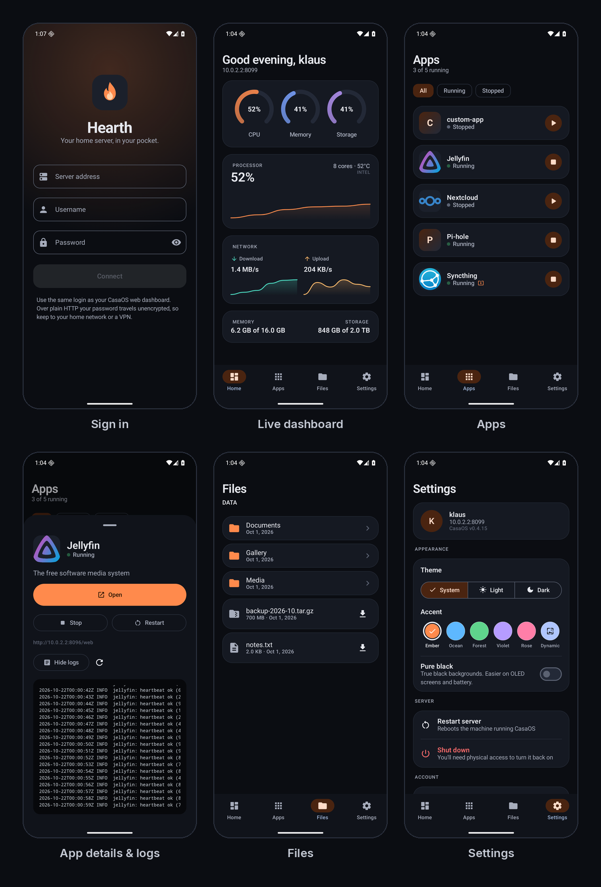
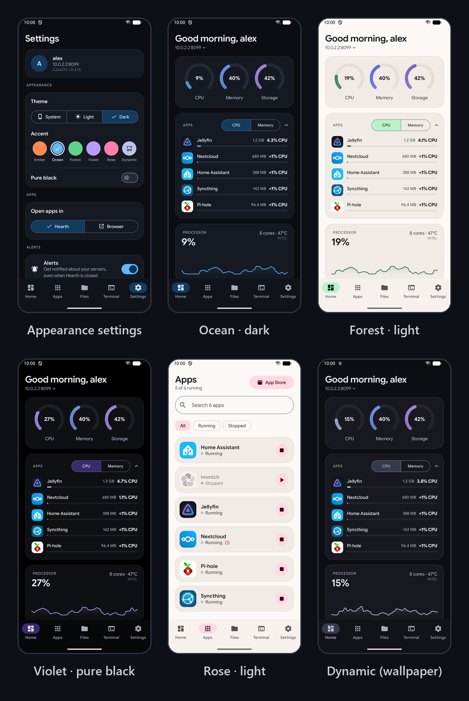

# Hearth

A native Android app for [CasaOS](https://casaos.io). Check your server's stats, manage apps, browse files and open a terminal, all from your phone.



## Features

- **Home**: live CPU, memory, storage and network stats, plus CPU and memory for each app
- **Apps**: start, stop and update apps, edit their settings, switch versions and view logs
- **App Store**: browse and install apps from your server's stores
- **Files**: browse, preview, upload, download and search everything on the server
- **Terminal**: an SSH shell with a one-tap server update
- **Multiple servers**: save several servers and switch between them
- **Lock**: optional fingerprint, face or PIN lock
- **Widget**: your server's stats on the home screen
- **Themes**: light, dark, pure black and six accent colors



## Build

Open the project in Android Studio, or from the command line:

```
./gradlew :app:assembleDebug
```

For setup details, how each feature works, the CasaOS API calls and security notes, see [How Hearth works](docs/how-it-works.md).

## Security

CasaOS uses plain HTTP by default, so your password isn't encrypted on the network. Stay on your home network or use a VPN when you're away.
